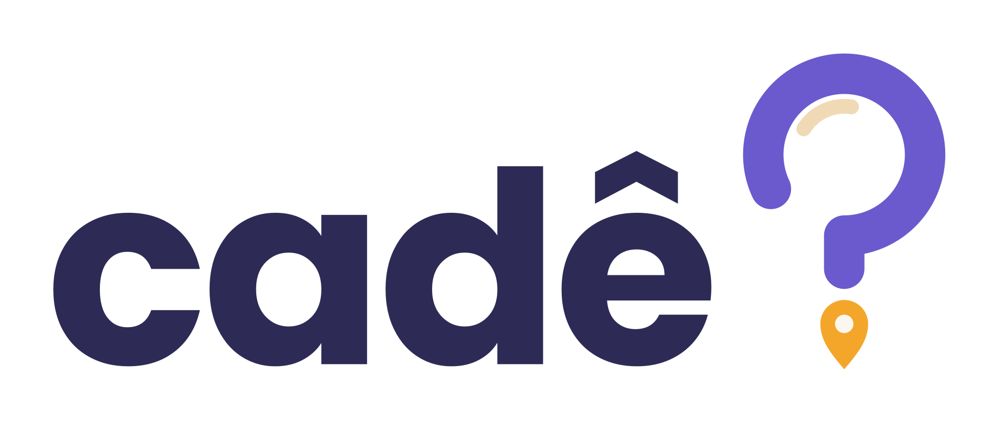

<p align="center">
  
</p>

# Cadê? — Achados e perdidos do campus UCSAL

Trabalho de **Front-End**: protótipo navegável, mobile-first (390 × 844), de um sistema de achados e perdidos do campus da UCSAL (Salvador).

Quem encontra um objeto no campus publica o item com foto, categoria, local e data. Quem perdeu algo busca e filtra os itens por categoria ou local para recuperá-lo.

## Ver o protótipo

👉 **https://clarareboucassnt-create.github.io/cade/**

Os itens que você publica e os pedidos de "É meu!" ficam guardados só no navegador que você está usando (`localStorage`). Para começar do zero, use **Perfil → Apagar meus dados de teste**.

## Funcionalidade principal

Dois fluxos completos e clicáveis, usados no teste com usuários:

1. **Publicar** um item encontrado.
2. **Buscar** itens com filtros e solicitar a devolução (**"É meu!"**).

## Personas

- Aluno que perdeu algo
- Funcionário da portaria

## Restrições

- Sem back-end, banco de dados ou autenticação real — dados simulados no front-end (estado local + `localStorage`), com itens de exemplo pré-carregados.
- Login apenas visual.
- Mobile-first, tema claro único, interface simples, consistente e acessível (contraste ≥ 4,5:1, foco visível, elementos semânticos).

## Identidade visual (resumo)

| Token | Cor |
|---|---|
| Fundo (creme) | `#FBF7F0` |
| Texto principal (índigo) | `#2D2B55` |
| Primária (violeta) | `#6A5ACD` |
| Destaque (âmbar) | `#F4A62A` |
| Lavanda (decorativo) | `#A678B9` |
| Areia | `#F0D9B5` |

Tipografia: **Poppins** (títulos e botões) e **Inter** (textos). Ícones estilo Lucide.


## Estrutura do repositório

```
index.html                 tela Entrar (login simulado)
inicio.html / inicio.js    tela Início, com chips de categoria
busca.html / busca.js      busca, folha de filtros e estado vazio
item.html / item.js        detalhe de qualquer item (item.html?id=...) e o modal "É meu!"
publicar.html / .js        formulário Publicar item, com validação
meus-itens.html / .js      abas Publicados e Minhas solicitações
perfil.html / perfil.js    perfil e "apagar meus dados de teste"
comum.js                   dados de exemplo e funções usadas por todas as telas
style.css                  todos os estilos
assets/marca/              logos e ícones do app
data/itens-exemplo.json    categorias, locais e itens de exemplo
docs/especificacao.md      especificação completa (telas, componentes, cores, acessibilidade)
docs/pesquisa-ideias.md    ideias avaliadas antes da escolha do tema
```

## Telas

1. Entrar
2. Início
3. Busca e filtros
4. Detalhe do item (+ modal "É meu!")
5. Publicar item (+ tela de sucesso)
6. Meus itens

Detalhes em [`docs/especificacao.md`](docs/especificacao.md).
